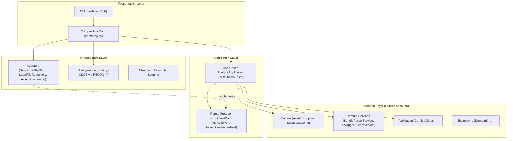

# Arquitetura Técnica: Supabase Recon

Este documento detalha o desenho arquitetural do **Supabase Recon**, fundamentado nos princípios de **Domain-Driven Design (DDD)** e **Clean Architecture / Arquitetura Hexagonal (Ports & Adapters)**.

---

## 1. Visão Geral das Camadas

A arquitetura organiza-se em 4 camadas com fluxo unidirecional de dependência voltado para o centro (Domínio):

---

## 2. Responsabilidades por Camada

### 2.1 Camada de Domínio (`app/src/domain/`)
- **Papel**: Encapsular a lógica de negócio pura e invariantes do processo de engenharia reversa e modelagem Supabase.
- **Componentes**:
  - `entities/`: Modelos com tipagem estrita (`Asset`, `Endpoint`, `SupabaseConfig`).
  - `services/`:
    - `BundleParserService`: Análise de código compilado, extração de configurações Supabase e mapeamento de rotas (REST, RPC, Functions, Auth).
    - `SwaggerBuilderService`: Transformação de endpoints de domínio em especificação estruturada OpenAPI 3.0.
  - `validation/`: `ConfigValidator` para checagem de URLs válidas e formatos de anon key.
  - `exceptions.py`: Hierarquia canônica de erros de domínio.
- **Invariantes**: Zero dependências externas de I/O, rede, filesystem ou formatação visual. Sem chamadas a loggers.

### 2.2 Camada de Aplicação (`app/src/application/`)
- **Papel**: Orquestrar fluxos de trabalho e definir contratos abstratos de integração.
- **Componentes**:
  - `ports/`: Interfaces abstratas via `typing.Protocol`:
    - `HttpClientPort`: Contrato para despacho de requisições HTTP seguras.
    - `FileRepositoryPort`: Contrato para gravação e persistência de arquivos.
    - `AssetDownloaderPort`: Contrato para download de assets estáticos.
  - `use_cases/`:
    - `AnalyzeApplication`: Orquestra o ciclo de vida de análise de uma URL alvo.
    - `ApiReliabilityTester`: Executa testes de disponibilidade e auditoria de RLS com anon key.
- **Invariantes**: Depende exclusivamente do Domínio e das Portas abstratas. Nunca importa adaptadores concretos.

### 2.3 Camada de Infraestrutura (`app/src/infrastructure/`)
- **Papel**: Fornecer implementações concretas para as portas da aplicação e gerenciar recursos externos.
- **Componentes**:
  - `adapters/`: Adaptadores HTTP baseados em `requests`, implementações de filesystem e downloaders com retries e proteção anti-SSRF.
  - `config/`: Centralização da classe `Settings` carregando variáveis `RECON_*`.
  - `logging/`: Subsistema de logging semântico estruturado com mascaramento automático de credenciais.

### 2.4 Camada de Apresentação (`app/src/presentation/`)
- **Papel**: Interagir com o usuário via terminal e atuar como Composition Root.
- **Componentes**:
  - `cli/bootstrap.py`: O único local autorizado a instanciar adaptadores e injetá-los nos casos de uso.
  - Componentes Rich para renderização de tabelas, painéis e barras de progresso.
